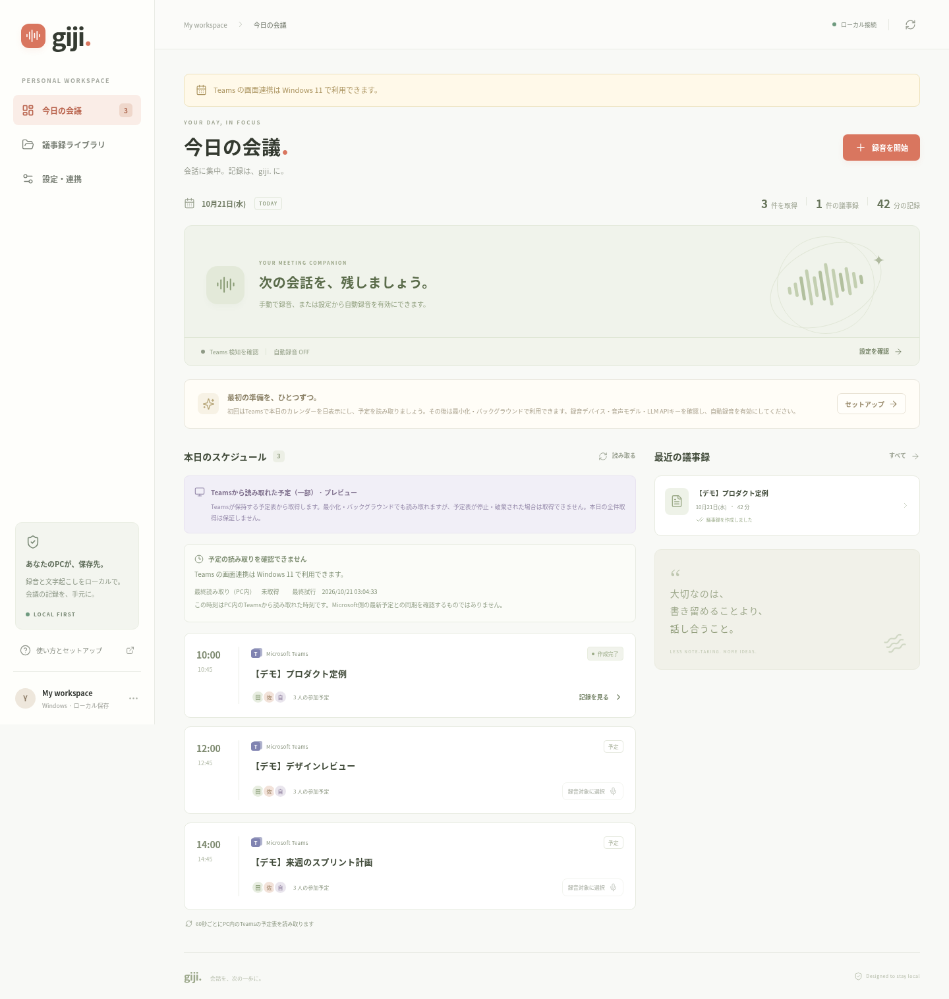

# Giji AutoMemo

**会議に集中する。記録は、あとから整う。**

Windows 11で動く、Teams会議の録音・文字起こし・議事録生成アプリです。**Teamsデスクトップのカレンダー**から今日の予定を読み取り、自分と相手の音声をPC内に保存。退出を検知すると文字起こし・話者分離を行い、手持ちのOpenAI互換LLM APIで日本語の議事録を作ります。

**標準の予定連携にOutlook、Microsoft Entraのアプリ登録、クライアントID、Microsoft用APIキーは不要です。** このPCでサインイン済みのTeamsのカレンダーを表示し、Windows UI Automationで読み取ります。通常は管理者権限・Teams再起動・デバッグ接続の設定も不要です。Windows用の同梱版には実行環境・画面・音声モデルが入っており、Python・Node.js・Gitのインストールや通常利用時のモデル取得も不要です。

**v0.4のTeamsデスクトップ連携はプレビューです。** Teamsの画面情報を読むため、表示状態・言語・Teamsの更新に依存します。実際のTeamsアカウントを使ったWindows実機での予定取得は、この開発環境では未検証です。接続できない場合は状態に表示し、OutlookやGraphへ勝手に切り替えません。[対応範囲と設定](docs/teams-desktop.md)

**最小化・非表示でも、Teamsが保持するカレンダー情報の読み取りを試します。ただし、トレイに入れたまま常に全予定を取得する要件は満たせていません。** 最初にTeamsで今日の日表示を開く必要があり、その後Teamsが画面を破棄・休止した場合は取得できません。予定の読取り処理がTeamsを復元・前面化・クリックすることはありません。

アプリ利用料、ローカル文字起こし・話者分離の従量料金、クラウドサーバー代はありません。**LLM APIの利用料は契約先の料金に従います。** 既存のTeams利用環境とPCは必要です。



[議事録画面](docs/screenshots/minutes.png) · [設定画面](docs/screenshots/settings.png) · [検証結果](docs/verification.md)

画面画像はv0.4のアプリをLinuxで起動したデモです。Windows実機でのTeams連携を示すものではありません。設定手順は [接続ガイド](docs/teams-desktop.md) を参照してください。

## ダウンロードして起動

1. [v0.4.0 リリース](https://github.com/kitworks-iino/giji-automemo/releases/tag/v0.4.0)の **`giji-automemo-windows-x64.zip`** をダウンロードします。
2. ZIPをすべて展開します。ZIP内から直接起動せず、展開した `GijiAutoMemo` フォルダー内の `models` と `_internal` をEXEのそばに置いたままにしてください。
3. Teamsデスクトップにサインインし、カレンダーを **今日** の **日** 表示にします。
4. 展開した **`GijiAutoMemo.exe`** をダブルクリックします。ブラウザーにホーム画面が開きます。
5. 設定画面で取得元 **Teamsデスクトップ**、標準の **Teamsが保持する予定表を読み取る** を確認し、今日の予定を読み取ります。録音デバイス、LLMのAPIキー・モデル・送信先を確認し、録音と外部送信への同意、自動録音を設定します。

v0.2で保存した予定の取得元は更新後も保持します。Teamsを使う場合は取得元を変更して保存してください。アプリがTeamsの画面を自動操作することはありません。最初に今日の日表示を利用者が開き、読取りを確認した後は最小化できます。最小化・トレイ格納後も取得できるかは、Teamsがカレンダー情報を保持するかによります。[連携の手順と取得範囲](docs/teams-desktop.md)

**起動時のコンソールは開いたままにしてください。** ブラウザーのタブを閉じても処理は続きます。ホームを開き直すにはEXEをもう一度起動します。アプリの終了はコンソールで `Ctrl+C`。スリープ中・電源OFF中には動作しません。

対象は **Windows 11 x64**、メモリ16GBを推奨します。GPUは不要です。処理時間と必要な空き容量は会議の長さや選択モデルによって変わります。標準のWhisper `small` と話者分離モデルは同梱されています。別の文字起こしモデルを選ぶ場合は追加取得が必要です。

EXEはコード署名していません。組織の実行制限やMicrosoftの保護機能により起動できない場合があります。制限を回避せず、組織の配布・実行手順に従ってください。配布物の内訳と確認方法は [Windows配布ガイド](docs/distribution.md) に記載しています。

> 自動処理には初回設定とアプリの常駐が必要です。実際のWindows端末・Teams・ヘッドセットでの確認は、[実機確認項目](docs/acceptance.md) に沿って行ってください。ビルドや自動テストだけで実機動作を保証するものではありません。

## できること

| 機能 | 実装 |
| --- | --- |
| 今日の予定 | Teamsが読み込んだカレンダー情報を標準60秒ごとに確認。最小化・非表示時も取得を試し、確認できた当日分を表示 |
| 自分と相手の録音 | マイクと再生デバイスのWASAPIループバックを別々のWAVへ保存 |
| 自動開始・終了 | Teamsデスクトップの参加状態を画面要素から推定。予定終了時刻では録音を切らない |
| 文字起こし | faster-whisperをPC内で実行。日本語を標準設定 |
| 話者分離 | sherpa-onnxで相手側の音声に話者ラベルを付け、自分のマイク音声と区別 |
| 議事録 | LLMで要約、決定事項、担当・期限つきToDo、議題、未解決事項を生成 |
| ホーム画面 | 予定、録音時間、音量、処理段階、議事録一覧、接続状態を表示 |
| 振り返り | 音声再生、話者名の編集、Markdown出力、失敗時の再処理 |
| デモ | 録音・API接続を使わず、明示されたサンプルデータで画面を確認 |

**文字起こしは録音終了後に行います。** 会議中のリアルタイム字幕ではありません。録音停止後、文字起こし → 話者分離 → 議事録生成の順に進みます。

## 普段の使い方

Teamsで今日のカレンダーを表示すると、読み取れた予定がホームに並びます。取得できない場合はエラー状態と最終読取り時刻を確認してください。保存済み予定が表示されても取得成功を意味せず、最終読取り時刻はMicrosoft側の最新情報との同期完了時刻ではありません。参加URLを読み取れた会議には参加操作を表示します。URLが取得できない予定は **録音対象に選択** してからTeams側で参加できます。標準の画面読み取りでは通常URLがないため、予定の件名を録音に使う場合はこの選択が必要です。未選択でも自動録音でき、予定と対応付けない件名で保存します。自動録音を有効にして参加状態を検知すると録音が始まるので、ホームの録音表示と2つの音量メーターを確認してください。

会議が延長しても予定時刻では停止しません。早く終わったときは退出状態が標準12秒続くと録音を止め、生成を始めます。手動で開始した録音も、Teams参加を検知済みなら退出に連動します。画面を読み取れない環境では手動で停止できます。

生成後はホームから議事録・文字起こし・音声を確認できます。相手側のラベルを実名に置き換えたい場合は話者名を編集してください。**声だけから実名を推測する機能ではありません。**

予定が見つからないときは [Teams連携の設定](docs/teams-desktop.md)、保存先・復旧・日常操作は [運用ガイド](docs/operations.md) を参照してください。Outlookや既存のGraph接続を明示的に選ぶ場合だけ、[代替の予定連携](docs/microsoft-setup.md)を使います。

## データと費用

- 音声、文字起こし、議事録、設定はPC内に保存します。LLM APIキーはWindowsの資格情報ストアへ保存します。
- 標準の予定連携は、同じPCのTeamsのカレンダー表示を読み取ります。Microsoftのパスワード、Cookie、アクセストークン、認証キャッシュを抽出しません。Graphや非公開の予定取得APIも呼びません。
- 同梱モデルを使う文字起こし・話者分離はオフラインで処理できます。最新予定の受信はTeams自身が行います。Teamsの同期とクラウドLLMにはネット接続が必要です。
- 標準の予定読み取りはレジストリを書き換えず、デバッグポートも開きません。詳細設定で任意のCDP方式を選ぶ場合だけ、接続準備とTeams再起動が必要です。[詳細方式の手順と終了方法](docs/teams-desktop.md)
- 外部LLMへ送るのは文字起こしなど議事録生成に必要なテキストです。録音ファイルは送りません。送信先は設定したAPIベースURLです。
- LLMキー未設定・外部送信OFFでも録音とローカル文字起こしは利用できます。議事録の生成にはキーと送信設定が必要です。
- 長い会議は分割して要約します。再処理を含め、LLM APIの利用料は契約先に従います。
- 録音と生成物は自動削除しません。不要なセッションは画面から削除し、必要な議事録はMarkdownで保存してください。

## 対応範囲

- Windows 11のTeamsデスクトップ版を対象にします。Teamsのカレンダーに読み取れる情報がない場合、予定は取得できません。日本語・英語の表示を対象とし、別の日付、仮想スクロール、他の言語、更新による構造変更では一部または全件を取得できない場合があります。
- Teamsの画面は読み取り専用です。カレンダー・予定・参加ボタンを自動クリックせず、Teamsの強制終了や自動再起動もしません。企業端末の実行・読み取り制限は回避しません。
- 標準方式はWindowsのタイムゾーンを使います。Teams側に別のタイムゾーンを設定している場合は、両方の設定を合わせて時刻を照合してください。
- Outlook（クラシック）と組織で設定済みのMicrosoft Graph接続は、詳細設定で明示的に選ぶ代替手段です。Teamsで失敗しても自動では利用しません。
- Teamsの参加・退出検知はWindows UI Automationによる推定です。画面構造の変更、アクセシビリティ情報不足、スリープなどの影響を受けます。不明のときは録音を継続し、手動停止を利用できます。
- Teams会議にボットを参加させる方式ではなく、Teams標準の録音通知も出ません。録音前に参加者への案内と必要な同意を済ませてください。
- 相手側は再生デバイス全体の音です。同じデバイスの通知音・動画音も録音されます。音の二重記録を避けるためヘッドセットを推奨します。
- Teamsでミュートしても、独立したマイク録音には自分の声が入り得ます。不要な会話はアプリで停止するか、マイク自体をミュートしてください。
- 音声認識・話者分離・LLMには誤りがあります。同時発話、短い発言、似た声、雑音では話者の誤割当が起きます。担当者や決定事項は原文・音声と照合してください。

## 開発者向け

通常利用には上のWindows同梱版を使ってください。GitHubの **Source code ZIP** や旧ソース配布ZIPは開発用で、実行環境・モデルを含むWindows版とは別です。

ソースから動かす場合は **標準CPython 3.13 x64を推奨** します。実験的なfree-threaded版は対象外です。`setup.ps1` は3.13を優先し、見つからなければ3.12、3.11の順に利用します。Node.js 22.12以上とGitも用意し、組織で許可されたPowerShell環境で実行します。

```powershell
git clone https://github.com/kitworks-iino/giji-automemo.git
cd giji-automemo
powershell -NoProfile -File .\scripts\setup.ps1
powershell -NoProfile -File .\scripts\start.ps1
```

ソース版の初回は依存関係のセットアップと音声モデルの取得が必要です。既存の仮想環境は自動でPython 3.13へ変わりません。ソース版で版を変更する場合はアプリを終了し、`.venv` を退避してからセットアップをやり直します。Windows同梱版はPython 3.13を含むため、利用者側のPython設定は不要です。ビルド済み画面を含む旧ソース配布ZIPでは `setup.ps1 -SkipFrontend` を使えます。

```powershell
.\.venv\Scripts\python.exe -m pip install -e ".[dev]"
.\.venv\Scripts\python.exe -m pytest
.\.venv\Scripts\python.exe -m ruff check .
cd frontend
npm ci
npm run build
```

構成はPython/FastAPI + SQLite + React/TypeScript/Vite。ローカルAPIはループバックに限定し、起動ごとのトークンで保護します。[実装の構成](docs/architecture.md)、[配布方法](docs/distribution.md)、[検証結果](docs/verification.md) も参照してください。

## デザインの参考

[Linear](https://linear.app/) の整理されたナビゲーションと状態表示、[Granola](https://www.granola.ai/) の会議とノートを中心にした画面を参考に、独自の日本語UIにしています。両サービスのコード・ロゴ・画像は使用していません。

## ライセンス

アプリのソースは [MIT](LICENSE)。依存パッケージと音声モデルはそれぞれのライセンスに従います。Windows同梱版は実行環境とモデルも配布するため、同梱のライセンス類と [主な依存物・モデル](docs/third-party.md) を確認してください。APIキー、Microsoftの認証情報、録音データは配布物・リポジトリに含めません。
