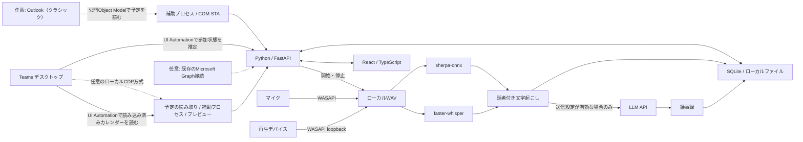

# 実装の構成

アプリは同じWindows PC上のブラウザー画面とローカルプロセスで動きます。v0.4のWindows配布版にはPython 3.13実行環境・画面・標準モデルを同梱します。ソースのセットアップも3.13を優先し、CIの対象は3.11と3.13です。各版の検証結果は [検証記録](verification.md) に分けて記載します。公開サーバーやMicrosoft Entraのアプリ登録は、標準の構成には必要ありません。

## モジュール

| 場所 | 役割 |
| --- | --- |
| `giji/__main__.py` | ループバックHTTPサーバー、ブラウザー、補助プロセスの起動入口 |
| `giji/api.py` | トークン認証、入力検証、音声・Markdown配信 |
| `giji/service.py` | 同期、録音、処理キュー、画面の状態を調整 |
| `giji/store.py` | SQLite永続化とOS資格情報ストア |
| `giji/lifecycle.py` | 会議との対応付け、録音の状態遷移 |
| `giji/calendar.py` | 標準のTeamsデスクトップと任意のOutlook・Graphを明示的に切り替える |
| `giji/teams_calendar_uia.py` | 標準の予定読み取り。UI Automationを時間制限つき補助プロセスで実行 |
| `giji/teams_calendar_parser.py` | 観測したカレンダーの日付・予定時刻を検証し、部分取得を識別 |
| `giji/teams_calendar.py` | 任意のCDP方式でTeams内の対象frameから表示情報を読む |
| `giji/teams_connection.py` | 任意のCDP接続の所有者確認、一時起動設定、復元・期限監視 |
| `giji/desktop_calendar.py` | 別プロセスのメインSTAスレッドからOutlook予定を取得 |
| `giji/microsoft.py` | 任意のMSALデバイスコード認証とGraph予定取得 |
| `giji/teams.py` | Teams画面の読み取りによる参加・退出の推定 |
| `giji/audio.py` | マイクとループバックの別録音 |
| `giji/models.py` | 同梱モデルの検出、追加モデルの取得、準備状態 |
| `giji/pipeline.py` | 文字起こし・話者分離・LLM要約・Markdown |
| `frontend/` | 日本語ホーム、会議詳細、設定画面 |

APIのエンティティとインターフェースは [CONTRACT.md](../CONTRACT.md) に記載しています。

## Teamsデスクトップからの予定読み取り

v0.4の標準取得元は、このPCにあるTeamsのカレンダーです。Windows UI Automationで、Teamsが保持するカレンダーのアクセシビリティ情報を確認します。標準方式はレジストリ設定やデバッグ接続を使わず、Teamsの再起動も要求しません。Teamsのウィンドウを復元・前面化せず、カレンダー・今日・日表示・予定・参加ボタンをクリックしません。

予定読み取りはメインスレッドをMTAにした補助プロセスで実行し、応答しないUIAプロバイダーを時間制限で切り離します。利用者が最初に今日の日表示を開き、標準60秒ごとに読み取れる予定を確認します。Windowsが最小化または非表示と判断した所有ウィンドウも探索し、その条件が確認された場合だけUIAの画面外判定を許容します。選択中のカレンダーであることと独立した日付情報を確認し、`aria-hidden` 等で明示的に隠された部分や非選択画面のキャッシュは除外します。日本語・英語の表示を対象とし、完全な日付と開始・終了時刻を確認できない予定は推測しません。標準方式の時刻はWindowsのタイムゾーンを前提にするため、Teamsが異なるタイムゾーンを表示している場合は両者を合わせて確認する必要があります。

最小化や非表示のウィンドウを探索することは、その内容が必ず存在することを意味しません。TeamsがWebViewを破棄・休止した場合や、カレンダーが未読込みの場合には取得できません。無条件のトレイ常駐・全件取得を実現する経路ではなく、カレンダーを自動で開く代替動作もありません。`last_sync` は画面の読取り成功時刻であり、Microsoft側のデータ更新や受信完了の証明ではありません。

Microsoftのパスワード、Cookie、アクセストークン、認証キャッシュは取得せず、Graphや非公開の予定APIも使いません。Teams内にOutlookのhosted calendarが表示されても、それはTeamsの画面であり、PCのOutlookアプリやCOMを必要としません。

画面外の仮想化された予定を含む全件取得は保証しません。部分取得は保存済みの当日予定へ追加・更新し、見えない予定を取消として削除しません。そのため古い予定が残る場合があります。カレンダーには対面の予定もあるので、自動の録音対応付けには直近に観測し、有効なTeams参加URLも読み取れた予定だけを使います。UIAでは通常URLを取得できず、件名を録音に使う場合は利用者が対象を明示選択します。未選択の自動録音は予定に対応付けず保存します。取得元や方式の変更では予定キャッシュをリセットします。

**Teamsのアクセシビリティ情報は、公開された安定した予定取得APIではありません。** Microsoftの説明はカレンダー操作と予定名・時刻の読み上げを裏付けますが、一定の要素属性や日時表現を保証するものではありません。Windows実機のTeams予定取得は未検証のプレビューです。[Teamsの読み上げ操作](https://support.microsoft.com/en-us/accessibility/teams/quick-start-guide-using-microsoft-teams-with-a-screen-reader)、[WebView2のUI Automation Provider](https://learn.microsoft.com/en-us/microsoft-edge/webview2/reference/winrt/interop/icorewebview2compositioncontrollerinterop)

## 任意のCDP方式

明示的に選ぶ詳細方式として、TeamsのWebView2が提供するローカルCDP接続でも表示情報を読み取れます。ユーザーごと・Teams実行ファイルごとの一時的な起動設定を使うため、会議のないときに利用者が準備操作とTeamsの完全終了・再起動を行います。Giji AutoMemoやTeamsの再起動で接続を失った場合も、この準備をやり直します。

一時設定は接続確認、10分の期限、解除、アプリ終了で復元します。独立した補助プロセスも期限とアプリ終了を監視します。ただし、起動中のTeamsのデバッグポートは設定復元だけでは閉じず、Teamsが終了するまで残ります。利用後の通常再起動を案内します。既存の管理設定は上書きしません。[MicrosoftのWebView2接続仕様](https://learn.microsoft.com/en-us/microsoft-edge/webview2/how-to/debug-visual-studio-code)

Teams内のカレンダーが別オリジン・別プロセスのiframeにある場合は、Teams配下の対象frame・targetを確認して対応するCDPセッションで読み取ります。Teamsに所有されるカレンダーの別ウィンドウも検証して対象にし、読み込み済みなら表示範囲外の要素を読む一方、非表示・非選択のキャッシュは除外します。ブラウザーの同一オリジン保護を無効にせず、非公開APIにも接続しません。この方式も復元・前面化・クリック・画面移動は行いません。[Teamsの構成](https://techcommunity.microsoft.com/blog/microsoftteamsblog/microsoft-teams-advantages-of-the-new-architecture/3775704)、[CDPの公式スキーマ](https://github.com/ChromeDevTools/devtools-protocol)

MicrosoftはWebView2ブラウザーフラグの本番利用を推奨していません。CDP方式の起動フラグやTeamsのDOMを安定した外部APIとして扱わず、WebViewの休止・破棄も考慮します。CDP接続や評価要求が必ず非表示WebViewを再開する保証はありません。[ブラウザーフラグの制限](https://learn.microsoft.com/en-us/microsoft-edge/webview2/concepts/webview-features-flags)、[TrySuspend / Resume](https://learn.microsoft.com/en-us/microsoft-edge/webview2/reference/win32/icorewebview2_3#trysuspend)

どちらの方式でも、予定取得の失敗を録音停止の条件には使わず、別の方式・取得元へ自動で切り替えません。利用手順と制限は [Teamsデスクトップ連携](teams-desktop.md) にあります。

## 任意のOutlookデスクトップ連携

クラシック版Outlookは、外部アプリから利用できるObject Modelを公開しています。このPCでサインイン済みのプロファイルから既定予定表を読み取り、開始時刻で並べた予定に `IncludeRecurrences` を適用して当日の会議を取得します。Windowsのローカル日付を使い、標準60秒ごとに同期します。[Application Object](https://learn.microsoft.com/en-us/office/vba/api/outlook.application)、[繰り返し予定の取得](https://learn.microsoft.com/en-us/office/vba/api/outlook.items.includerecurrences)

OutlookのCOM呼び出しには、プロファイル選択や保護機能による対話・応答待ちが発生し得ます。補助プロセスのメインスレッドをSTAとして実行し、アプリ本体がOutlookの応答で停止しないよう分離します。タイムアウトは同期エラーとして表示し、Object Model Guardや組織の設定は変更しません。

Outlookの連携でもMicrosoftのパスワード、Cookie、アクセストークンを抽出・保存しません。「新しいOutlook」とWeb版はこのCOM経路の対象外です。組織で既存のGraph接続がある場合に限り、詳細設定から従来の `calendarView` 取得も利用できます。[GraphのcalendarView](https://learn.microsoft.com/en-us/graph/api/calendar-list-calendarview?view=graph-rest-1.0)

## Teamsの参加状態

録音の参加・退出検知にはWindows UI Automationを使います。`hangup-button` などのTeams内部要素IDは、Microsoftが公開する安定したAPI契約ではありません。「参加中」「待機」「不明」「利用不可」を区別し、読み取り失敗では録音を切らず、手動操作を残しています。[Windows UI Automation](https://learn.microsoft.com/en-us/windows/win32/winauto/uiauto-uiautomationoverview)

Graphの `meetingCallEvents` はアプリケーション権限と通知受信基盤を要求するため、PC単体の構成では使用していません。[会議イベント通知の仕様](https://learn.microsoft.com/en-us/graph/changenotifications-for-onlinemeeting)

## 音声処理とモデル

録音はマイクと再生側を分け、マイクを `SELF` として扱います。再生側の複数話者にはクラスタラベルを付けます。参加者リストや声から実名を推測しません。複数人が同じマイクで話す場合、そのマイク側はひとつのラベルになります。

Windows同梱版ではEXEと同じ場所にある `models` を読み取り、標準のWhisper `small` と話者分離モデルを使います。完全な追加モデルが利用データ側にある場合はそちらを優先し、不足するモデルだけを設定画面から取得できます。起動時にモデルを無断でダウンロードしません。

LLMへ送るテキストは長さを制限して分割要約します。出力をJSONとして検証し、不正な応答を成功扱いしません。文字起こし内の命令には従わず、事実だけを記録するよう指示しています。ただし、認識・話者分離・LLM出力の正確性を保証するものではありません。

## 配布とローカルAPIの境界

Windows版は `GijiAutoMemo.exe`、`_internal` の実行環境、`models`、ライセンス類をまとめて配布します。EXEだけを取り出して使う形式ではありません。詳細は [配布ガイド](distribution.md) と [第三者ライセンス](third-party.md) を参照してください。

ブラウザーUIはループバックHTTP経由で同じPCのバックエンドに接続します。起動ごとの認証トークンはURLフラグメントから受け取り、APIリクエストの認証に使います。LLMキーや任意のGraph認証トークンを画面へ返しません。ブラウザーへ絶対ファイルパスを返さず、保存されたセッションの音声だけを配信します。

外部公開用の認証・ユーザー分離・TLS終端を備えたサーバー製品ではありません。ポート転送や公開ホストへのbindを追加してインターネット公開しないでください。GitHubで公開するのはソースコードと配布物であり、利用者の音声や議事録ではありません。
