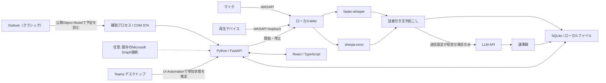

# 実装の構成

アプリは同じWindows PC上のブラウザー画面とローカルプロセスで動きます。Windows配布版にはPython実行環境・画面・標準モデルを同梱します。公開サーバーやMicrosoft Entraのアプリ登録は、標準の構成には必要ありません。

## モジュール

| 場所 | 役割 |
| --- | --- |
| `giji/__main__.py` | ループバックHTTPサーバー、ブラウザー、補助プロセスの起動入口 |
| `giji/api.py` | トークン認証、入力検証、音声・Markdown配信 |
| `giji/service.py` | 同期、録音、処理キュー、画面の状態を調整 |
| `giji/store.py` | SQLite永続化とOS資格情報ストア |
| `giji/lifecycle.py` | 会議との対応付け、録音の状態遷移 |
| `giji/calendar.py` | 標準のOutlookデスクトップと任意のGraph接続を切り替える |
| `giji/desktop_calendar.py` | 別プロセスのメインSTAスレッドからOutlook予定を取得 |
| `giji/microsoft.py` | 任意のMSALデバイスコード認証とGraph予定取得 |
| `giji/teams.py` | Teams画面の読み取りによる参加・退出の推定 |
| `giji/audio.py` | マイクとループバックの別録音 |
| `giji/models.py` | 同梱モデルの検出、追加モデルの取得、準備状態 |
| `giji/pipeline.py` | 文字起こし・話者分離・LLM要約・Markdown |
| `frontend/` | 日本語ホーム、会議詳細、設定画面 |

APIのエンティティとインターフェースは [CONTRACT.md](../CONTRACT.md) に記載しています。

## Outlookデスクトップを標準にした理由

クラシック版Outlookは、外部アプリから利用できるObject Modelを公開しています。このPCでサインイン済みのプロファイルから既定予定表を読み取り、開始時刻で並べた予定に `IncludeRecurrences` を適用して当日の会議を取得します。Windowsのローカル日付を使い、標準60秒ごとに同期します。[Application Object](https://learn.microsoft.com/en-us/office/vba/api/outlook.application)、[繰り返し予定の取得](https://learn.microsoft.com/en-us/office/vba/api/outlook.items.includerecurrences)

OutlookのCOM呼び出しには、プロファイル選択や保護機能による対話・応答待ちが発生し得ます。補助プロセスのメインスレッドをSTAとして実行し、アプリ本体がOutlookの応答で停止しないよう分離します。タイムアウトは同期エラーとして表示し、Object Model Guardや組織の設定は変更しません。

標準の連携ではMicrosoftのパスワード、Cookie、アクセストークンを抽出・保存しません。「新しいOutlook」とWeb版はこの経路の対象外です。組織で既存のGraph接続がある場合に限り、詳細設定から従来の `calendarView` 取得も利用できます。[GraphのcalendarView](https://learn.microsoft.com/en-us/graph/api/calendar-list-calendarview?view=graph-rest-1.0)

## TeamsのCDPと参加状態

TeamsのWebView2にCDPで接続することは技術的には可能ですが、Microsoftの手順ではデバッグ引数の設定とホストアプリの再起動が必要です。WebView2のブラウザーフラグは本番アプリで使わないよう説明されており、予定のDOM取得はTeamsの表示内容にも依存します。このため、配布版の予定取得には採用していません。Teamsのデバッグ設定やレジストリを変更する実装はありません。[WebView2の接続手順](https://learn.microsoft.com/en-us/microsoft-edge/web-platform/devtools-mcp-server#auto-connect-to-a-webview2-instance)、[ブラウザーフラグの扱い](https://learn.microsoft.com/en-us/microsoft-edge/webview2/concepts/webview-features-flags)

録音の参加・退出検知にはWindows UI Automationを使います。`hangup-button` などのTeams内部要素IDは、Microsoftが公開する安定したAPI契約ではありません。「参加中」「待機」「不明」「利用不可」を区別し、読み取り失敗では録音を切らず、手動操作を残しています。[Windows UI Automation](https://learn.microsoft.com/en-us/windows/win32/winauto/uiauto-uiautomationoverview)

Graphの `meetingCallEvents` はアプリケーション権限と通知受信基盤を要求するため、PC単体の構成では使用していません。[会議イベント通知の仕様](https://learn.microsoft.com/en-us/graph/changenotifications-for-onlinemeeting)

## 音声処理とモデル

録音はマイクと再生側を分け、マイクを `SELF` として扱います。再生側の複数話者にはクラスタラベルを付けます。参加者リストや声から実名を推測しません。複数人が同じマイクで話す場合、そのマイク側はひとつのラベルになります。

Windows同梱版ではEXEと同じ場所にある `models` を読み取り、標準のWhisper `small` と話者分離モデルを使います。完全な追加モデルが利用データ側にある場合はそちらを優先し、不足するモデルだけを設定画面から取得できます。起動時にモデルを無断でダウンロードしません。

LLMへ送るテキストは長さを制限して分割要約します。出力をJSONとして検証し、不正な応答を成功扱いしません。文字起こし内の命令には従わず、事実だけを記録するよう指示しています。ただし、認識・話者分離・LLM出力の正確性を保証するものではありません。

## 配布とローカルAPIの境界

Windows版は `GijiAutoMemo.exe`、`_internal` の実行環境、`models`、ライセンス類をまとめて配布します。EXEだけを取り出して使う形式ではありません。詳細は [配布ガイド](distribution.md) と [第三者ライセンス](third-party.md) を参照してください。

ブラウザーUIはループバックHTTP経由で同じPCのバックエンドに接続します。起動ごとの認証トークンはURLフラグメントから受け取り、APIリクエストの認証に使います。LLMキーや任意のGraph認証トークンを画面へ返しません。ブラウザーへ絶対ファイルパスを返さず、保存されたセッションの音声だけを配信します。

外部公開用の認証・ユーザー分離・TLS終端を備えたサーバー製品ではありません。ポート転送や公開ホストへのbindを追加してインターネット公開しないでください。GitHubで公開するのはソースコードと配布物であり、利用者の音声や議事録ではありません。
