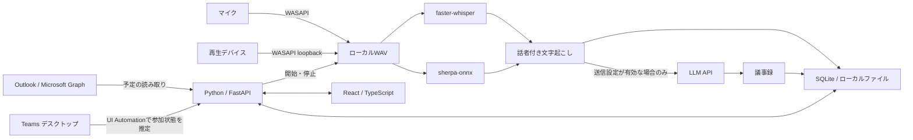

# 実装の構成

アプリは同じWindows PC上のブラウザー画面とPythonプロセスで動きます。公開サーバーへの配置は必要ありません。

## モジュール

| 場所 | 役割 |
| --- | --- |
| `giji/__main__.py` | ループバックHTTPサーバーとブラウザーの起動 |
| `giji/api.py` | トークン認証、入力検証、音声・Markdown配信 |
| `giji/service.py` | 同期、録音、処理キュー、画面の状態を調整 |
| `giji/store.py` | SQLite永続化とOS資格情報ストア |
| `giji/lifecycle.py` | 会議との対応付け、録音の状態遷移 |
| `giji/microsoft.py` | MSALのデバイスコード認証とGraph予定取得 |
| `giji/teams.py` | Teams画面の読み取りによる参加/退出の推定 |
| `giji/audio.py` | マイクとループバックの別録音 |
| `giji/models.py` | ユーザー操作によるモデル取得と準備状態 |
| `giji/pipeline.py` | 文字起こし・話者分離・LLM要約・Markdown |
| `frontend/` | 日本語ホーム、会議詳細、設定画面 |

APIのエンティティとインターフェースは [CONTRACT.md](../CONTRACT.md) に記載しています。

## 選択理由と限界

Outlookの `calendarView` は日付範囲内の繰り返し・例外・単発予定を取得できます。同期はPC起動中のポーリングで、常設Webhookサーバーを必要としません。[Microsoft仕様](https://learn.microsoft.com/en-us/graph/api/calendar-list-calendarview?view=graph-rest-1.0)

Microsoft Graphにも会議開始・終了イベントがありますが、`meetingCallEvents` はアプリケーション権限と通知受信基盤を要求します。今回のPC単体構成では使用していません。[Microsoft仕様](https://learn.microsoft.com/en-us/graph/changenotifications-for-onlinemeeting)

Teams監視にはWindows UI Automationを使います。`hangup-button` などのTeams内部の要素IDはMicrosoftが公開する安定したAPI契約ではありません。そのため「参加中」「待機」「不明」「利用不可」を区別します。読取失敗で録音を切らず、手動操作を残しています。[Windows UI Automation](https://learn.microsoft.com/en-us/windows/win32/winauto/uiauto-uiautomationoverview)

録音はマイクと再生側を分け、マイクを `SELF` として扱います。再生側の複数話者はクラスタラベルを付けます。参加者リストや声から実名を推測しません。複数人が同じマイクで話す場合、そのマイク側はひとつのラベルになります。

LLMへ送るテキストは長さを制限して分割要約します。出力をJSONとして検証し、不正な応答を成功扱いしません。文字起こし内の命令には従わず、事実だけを記録するよう指示しています。ただしLLM出力の正確性を保証するものではありません。

## ローカルAPIの境界

ブラウザーUIはループバックHTTP経由で同じPCのPythonに接続します。起動ごとの認証トークンはURLフラグメントから受け取り、APIリクエストの認証に使います。LLMキーやMicrosoftトークンを画面へ返しません。ブラウザーへ絶対ファイルパスを返さず、保存されたセッションの音声だけを配信します。

外部公開用の認証・ユーザー分離・TLS終端を備えたサーバー製品ではありません。ポート転送や公開ホストへのbindを追加してインターネット公開しないでください。GitHubで公開するのはソースコードです。
